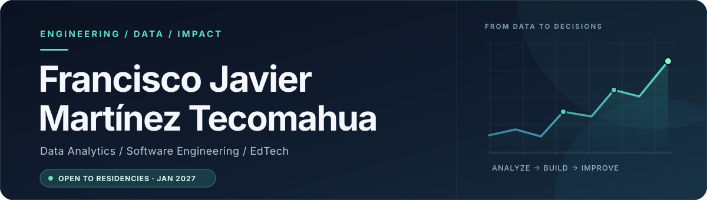

  

   

  <a href="https://suordd.github.io/javier-martinez-portfolio/"><strong>Explore my portfolio</strong></a>
  &nbsp;&nbsp;·&nbsp;&nbsp;
  <a href="https://www.linkedin.com/in/tecomahua">LinkedIn</a>
  &nbsp;&nbsp;·&nbsp;&nbsp;
  <a href="mailto:fjmt0716@gmail.com">Contact</a>

 

## About

I'm a **Computer Systems Engineering student** at the **Instituto Tecnológico de Orizaba (TecNM)**, focused on **Data Analytics, Data Science, and Software Engineering**.

I enjoy working across the full problem-solving process: understanding a challenge, preparing and analyzing data, building applications, and translating findings into practical solutions. My current work centers on **educational technology and data-informed products**.

> **Next step:** Professional residency / internship starting **January 2027**, ideally in Data Analytics, Data Science, or related engineering roles.

## Selected work

### 01 / SPA Market Opportunity Analysis
**From public data to a business recommendation** · *Academic team project, 2026*

Explored the feasibility of opening a wellness business in Orizaba, Veracruz, using **INEGI ENIGH 2024, DENUE, and 2020 Census** data. The work combines data cleaning, exploratory analysis, weighted statistics, competitive mapping, KPIs, and data storytelling. Findings are presented alongside the limitations of the available data.

`Python` `pandas` `NumPy` `Exploratory Data Analysis` `Data Storytelling`

### 02 / Inglés Chido
**Building an accessible English-learning experience** · *Founder & developer, ongoing*

Developing a mobile application with interactive learning paths, lessons, and progress tracking. A **learning analytics and data-driven personalization module is planned** to explore patterns in learner performance and recommend more relevant study activities.

`React Native` `Expo` `TypeScript` `EdTech` `Learning Analytics (planned)`

### 03 / STI-NEM
**Teacher-facing tools for an intelligent mathematics tutoring project** · *Social service contributor, 2026*

Contributing to the frontend of the **Sistema Tutor Inteligente para la Nueva Escuela Mexicana**, including teacher dashboards, student and group management, reusable UI components, typed API adapters, and form validation.

`Next.js` `React` `TypeScript` `Zod` `Frontend Engineering`

  <a href="https://suordd.github.io/javier-martinez-portfolio/">View case studies and project visuals →</a>

## Technical toolkit

| Data & analytics | Software & platforms |
| :--- | :--- |
| **Languages:** Python, SQL | **Languages:** TypeScript, JavaScript, Java |
| **Libraries:** pandas, NumPy, scikit-learn | **Frontend:** React, Next.js, React Native, Expo |
| **Methods:** EDA, statistics, data cleaning | **Backend & data:** PostgreSQL, MySQL, REST APIs |
| **Reporting:** Power BI, Excel, KPI visualization | **Workflow:** Git, GitHub |

## Beyond the code

- **Education:** B.Eng. in Computer Systems Engineering, Instituto Tecnológico de Orizaba — in progress.
- **Languages:** Spanish (native) · English (B2).
- **Current interests:** Applied analytics, personalized learning, data-informed product development.

---

  <strong>Interested in collaborating?</strong>

   

  Explore my <a href="https://suordd.github.io/javier-martinez-portfolio/">portfolio</a> or connect with me on <a href="https://www.linkedin.com/in/tecomahua">LinkedIn</a>.

    

  Building thoughtfully · Learning continuously · Grounding decisions in evidence

